# End-to-End System Architecture: AI Trend-Jacking Discord Agent

---

## 1. System Topology & Data Flow

```mermaid
flowchart TD
    subgraph DataIngestion ["1. Trend Ingestion Engine (Every 30–60m)"]
        GT["Google Trends RSS\n(Realtime trending searches)"]
        RD["Reddit API (PRAW)\n(Hot threads in r/all, r/technology, etc.)"]
        HN["Hacker News / NewsAPI\n(Top stories & velocity)"]
    end

    subgraph FilterLayer ["2. Filter & Deduplication Engine"]
        Blacklist["Safety Filter\n(Blacklist: Tragedies, Wars, Violence)"]
        Dedup["SQLite Database\n(Deduplication within 48h)"]
        Scorer["Velocity Scorer\n(Spike percentage & engagement velocity)"]
    end

    subgraph IntelligenceLayer ["3. Context & Sarcasm Synthesizer (LLM)"]
        Scraper["Snippet Fetcher\n(Top 3 article summaries / Reddit comments)"]
        IronyEngine["Conflict & Irony Parser\n(The Core Contradiction, Camp A vs Camp B)"]
        Copywriter["Multi-Persona Drafter\n(X Quip, LinkedIn Satire, Cynical Hot Take)"]
    end

    subgraph DiscordWarRoom ["4. Discord Interactive Cockpit"]
        Embed["Rich Discord Embed\n(Velocity badge, Context, 3 Drafts)"]
        Buttons["Interactive Action Bar\n(1-Tap X Tweet, Copy LI, Edit, Regen)"]
        Thread["Auto-Generated Thread\n(Live chat iteration with LLM)"]
    end

    subgraph ActionBridge ["5. Outbound Publishing Bridge"]
        XIntent["Twitter Web Intent URL\n(Opens X with draft pre-filled)"]
        Clipboard["Modal / Text Block\n(Instant copy for LinkedIn / Reddit)"]
    end

    DataIngestion --> FilterLayer
    FilterLayer --> IntelligenceLayer
    IntelligenceLayer --> DiscordWarRoom
    DiscordWarRoom --> ActionBridge
```



---

## 2. Component Breakdown

### Component 1: Trend Ingestion Engine
Runs on a scheduled background loop (`APScheduler` or `asyncio.sleep`).
* **Google Trends RSS**: Completely free, updates every 15–30 minutes, breaks down search volume by region (US, Global, etc.).
* **Reddit PRAW (`reddit.subreddit("all").hot(limit=25)`)**: Tracks upvote velocity (`ups / age_in_seconds`) and comment counts.
* **Hacker News Firebase API**: Monitors fast-rising tech/business items.

### Component 2: Safety & Velocity Filter
Before sending anything to the LLM, the raw trend must pass two gates:
1. **Safety / Tragedy Guardrail**: Keyword blacklist checking against terms related to fatal accidents, war casualties, health emergencies, and sensitive political topics to ensure the agent never produces inappropriate satire.
2. **Deduplication & Recency**: Stores a hash of the trend topic in SQLite. If flagged in the last 48 hours, it's discarded to prevent alert spam.

### Component 3: The Context & Irony Synthesizer
Uses a fast, low-cost LLM (e.g., Gemini 1.5 Flash / Claude 3.5 Haiku) with a structured prompt:
1. **Context Extraction**: What happened in 2 sentences?
2. **The Contradiction / Irony**: Where is the absurd hypocrisy or failure?
3. **The Two Camps**: What is Camp A saying vs Camp B?
4. **Draft 1 (X / Twitter)**: Max 240 chars, dry cynical wit, high hook value.
5. **Draft 2 (LinkedIn)**: Corporate parody ("What this taught me about Q3 deliverables...").
6. **Draft 3 (Sharp Observation)**: Thought-provoking cultural irony.

### Component 4: Discord Bot Architecture (`discord.py`)
Built using modern Discord UI components (`discord.ui.View`, `discord.ui.Button`, `discord.ui.Modal`):

1. **Rich Embed**: Visual hierarchy displaying:
   * Category icon + Trend Title.
   * Freshness Badge (`🟢 Breaking`, `🟡 Peaking`).
   * "The Irony" context box.
   * Monospace code blocks for the 3 drafts (so mobile users can tap to copy instantly).
2. **Button Component Grid**:
   * `[ 🐦 Post to X ]` (Link Button): Direct deep link to `https://twitter.com/intent/tweet?text=<encoded_draft>`.
   * `[ ✏️ Edit Draft ]` (Interactive Button): Opens a Discord Modal text box for you to tweak copy right inside Discord.
   * `[ 🔄 Regenerate ]` (Interactive Button): Re-runs the LLM with a higher temperature or alternate comedic angle.
   * `[ ❌ Dismiss ]` (Interactive Button): Deletes/archives the message.
3. **Dedicated Discussion Thread**:
   * When an alert is posted, the bot calls `message.create_thread(name=trend_title)`.
   * You can reply inside the thread: *"Make Draft 1 shorter and more sarcastic about VCs."*
   * The bot listens to thread messages, passes the history back to the LLM, and prints an updated draft.

---

## 3. Database Schema (SQLite)

A lightweight `data/agent.db` SQLite database is sufficient:

```sql
-- Tracks discovered trends to prevent duplicates
CREATE TABLE trends (
    id INTEGER PRIMARY KEY AUTOINCREMENT,
    trend_hash TEXT UNIQUE NOT NULL,
    source TEXT NOT NULL,           -- 'google', 'reddit', 'hackernews'
    title TEXT NOT NULL,
    velocity_score REAL,
    first_seen_at TIMESTAMP DEFAULT CURRENT_TIMESTAMP,
    status TEXT DEFAULT 'pending'   -- 'pending', 'approved', 'dismissed'
);

-- Stores generated posts and decisions for performance analytics
CREATE TABLE generated_drafts (
    id INTEGER PRIMARY KEY AUTOINCREMENT,
    trend_id INTEGER REFERENCES trends(id),
    discord_message_id TEXT,
    discord_thread_id TEXT,
    irony_summary TEXT,
    draft_x TEXT,
    draft_linkedin TEXT,
    draft_cynical TEXT,
    selected_option TEXT,           -- 'x', 'linkedin', 'custom', 'none'
    final_text TEXT,
    created_at TIMESTAMP DEFAULT CURRENT_TIMESTAMP
);
```

---

## 4. Project Directory Structure

```
trend_copilot/
├── config.py                 # API keys (Discord token, LLM key, Reddit client)
├── main.py                   # App entrypoint (initializes bot + scheduler)
├── requirements.txt          # discord.py, google-trends, praw, google-genai, etc.
│
├── ingestion/                # Trend collection
│   ├── __init__.py
│   ├── google_trends.py      # RSS feed parser
│   ├── reddit_trends.py      # PRAW scraper for hot discussions
│   └── filter.py             # Deduplication and tragedy blacklist
│
├── intelligence/             # LLM reasoning & copywriting
│   ├── __init__.py
│   ├── context_fetcher.py    # Fetches top news snippets / search results
│   ├── prompts.py            # System prompts (Irony breakdown & satirical voices)
│   └── drafter.py            # LLM API calls with structured output (Pydantic)
│
├── bot/                      # Discord interaction layer
│   ├── __init__.py
│   ├── client.py             # Discord Client initialization
│   ├── views.py              # Interactive Buttons & Link URL Intents
│   ├── modals.py             # Discord pop-up text editor
│   └── thread_handler.py     # Listens to thread comments for revisions
│
└── storage/                  # State management
    ├── __init__.py
    └── db.py                 # SQLite helper methods
```

---

## 5. Step-by-Step Implementation Roadmap

### Step 1: Discord Bot Setup & UI Framework
* Create bot in Discord Developer Portal, grant `Message Content Intent` and `Send Messages / Create Threads`.
* Build the mock Embed with the 3 sample drafts, the `[ 🐦 Post to X ]` link button, and the Modal edit button.
* Verify clicking the X button opens Twitter with pre-filled text on mobile and desktop.

### Step 2: Ingestion & Safety Filter
* Implement `google_trends.py` using Google Trends RSS feeds (free, no API key required).
* Implement `reddit_trends.py` to read `r/all/hot` or `r/technology/hot`.
* Build the blacklist matcher to skip sensitive or tragic world events.

### Step 3: LLM Context & Satirical Prompting
* Setup the LLM client (e.g. Gemini 1.5 Flash).
* Formulate the prompt template with 3 distinct satirical styles:
  * Style 1: Snappy one-liner / observational irony (X).
  * Style 2: B2B corporate hustle parody (LinkedIn).
  * Style 3: Cynical cultural hot take.
* Parse the LLM output into structured JSON.

### Step 4: The Thread Iteration Engine
* Hook up `on_message` event listener inside Discord threads.
* If a message is sent inside an alert thread by you, send the message + previous drafts back to the LLM as a revision instruction.
* Post the updated draft back into the thread.

### Step 5: Scheduler & Polling Daemon
* Use `APScheduler` to trigger the ingestion and drafting pipeline every 45 minutes during waking hours (e.g., 08:00 to 23:00).
* Set minimum velocity threshold to ensure you only get notified about significant spikes.
