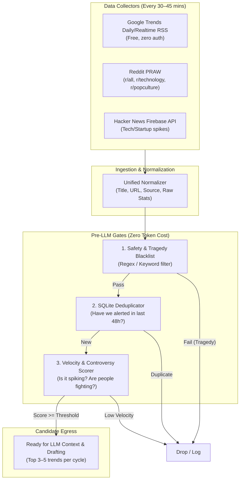

# Component 1 Implementation Plan: Trend Detection & Ingestion Engine

---

## 1. Objective & Scope

The purpose of **Component 1** is to continuously monitor the internet for breaking news, viral controversies, and surging discussions **without paying for expensive enterprise APIs**. 

It ingests data from disparate sources, normalizes it into a unified data structure, filters out tragedies/blacklisted topics, deduplicates against recently seen items, calculates an engagement velocity score, and passes only high-signal candidates to the LLM layer.



---

## 2. In-Depth Source Mechanics (Zero API Cost)

### A. Google Trends RSS Collector
* **Endpoint:** `https://trends.google.com/trending/rss?geo=US` (or other regions like `IN`, `GB`).
* **Why RSS?** Google Trends has no official public REST API, and unofficial libraries like `pytrends` break frequently due to rate-limiting and captcha blocks. Google's **official RSS feed** is fast, reliable, XML-standardized, and requires **no authentication**.
* **Payload Structure:**
  ```xml
  <item>
      <title>OpenAI Strawberry</title>
      <ht:approx_traffic>200,000+</ht:approx_traffic>
      <description>OpenAI launches new reasoning model...</description>
      <pubDate>Sun, 27 Sep 2026 02:00:00 GMT</pubDate>
      <ht:news_item>
          <ht:news_item_title>OpenAI Releases New Model</ht:news_item_title>
          <ht:news_item_url>https://news-source.com/...</ht:news_item_url>
      </ht:news_item>
  </item>
  ```
* **Extracted Attributes:** Search query, estimated search volume, initial news snippet, publication timestamp.

---

### B. Reddit Collector (`praw`)
* **Endpoint:** Reddit Free Tier OAuth (`praw` Python library).
* **Target Subreddits:**
  * `r/all` (General viral culture)
  * `r/technology` (Tech drama & product launches)
  * `r/popculturechat` or `r/entertainment` (Pop culture controversies)
  * `r/antiwork` or `r/recruitinghell` (Corporate absurdity for LinkedIn satire)
* **Secret Weapon Metric: The Controversy / Debate Ratio**:
  $$\text{Controversy Ratio} = \frac{\text{num\_comments}}{\text{upvotes} + 1}$$
  * An upvoted post with very few comments is just a cute video.
  * A post with **high comment velocity relative to upvotes** means **people are arguing**. This is prime fuel for satirical commentary.

---

### C. Hacker News Firebase API
* **Endpoint:** `https://hacker-news.firebaseio.com/v0/topstories.json` + `https://hacker-news.firebaseio.com/v0/item/{id}.json`.
* **Why:** 100% free, no API keys required, ultra-fast JSON responses.
* **Filter Criteria:** Stories with `score > 100` and `age < 4 hours`.

---

## 3. Normalized Data Model

Every raw trend is transformed into a standardized Pydantic model before filtering:

```python
from pydantic import BaseModel, Field
from datetime import datetime
from typing import Optional, List

class RawTrend(BaseModel):
    id: str                       # Computed hash: md5(source + slug(title))
    source: str                   # 'google_trends', 'reddit', 'hackernews'
    title: str                    # Cleaned trend title
    summary: Optional[str] = None # News summary or top Reddit selftext
    url: Optional[str] = None     # Primary source link
    raw_score: float              # Search volume, Reddit score, or HN score
    comment_count: int = 0
    published_at: datetime
    fetched_at: datetime = Field(default_factory=datetime.utcnow)
    category_hint: str = "general" # 'tech', 'corporate', 'entertainment', 'general'
```

---

## 4. The 3-Tier Pre-LLM Filter Pipeline

Running every internet spike through an LLM is wasteful and can lead to tone-deaf jokes about tragedies. Component 1 runs 3 strict pre-filters:

### Tier 1: Safety & Tragedy Blacklist (Zero Token Cost)
A regex and keyword-matching engine that screens out sensitive topics:
```python
SAFETY_BLACKLIST = [
    # Casualties & Accidents
    r"\b(killed|died|dead|death|fatal|shooting|plane crash|massacre|casualt)\w*",
    # Geopolitical & Armed Conflict
    r"\b(war|airstrike|bombing|hostage|terrorist|genocide|missile strike)\w*",
    # Health & Disease Outbreaks
    r"\b(epidemic|pandemic|ebola|outbreak|cancer diagnosis)\w*",
    # Severe Crimes
    r"\b(assault|homicide|pedophile|sexual abuse|trafficking)\w*"
]
```
If a trend matches any pattern in `SAFETY_BLACKLIST`, it is immediately discarded and logged as `status = 'dropped_safety'`.

### Tier 2: SQLite Deduplication (Recency Window)
To avoid alerting on the same topic twice in 48 hours:
* Normalizes the title into a clean slug (e.g., `"OpenAI Recalls Pin"` $\to$ `openai-recalls-pin`).
* Queries `trends` table:
  ```sql
  SELECT id FROM trends 
  WHERE slug = ? AND first_seen_at > datetime('now', '-48 hours');
  ```
* If found, the item is skipped.

### Tier 3: Velocity & Score Normalization
Different platforms measure engagement differently. We normalize all scores to a $0 - 100$ **Velocity Index**:
* **Google Trends:** $\text{Score} = \min(100, \frac{\text{approx\_traffic}}{2000})$
* **Reddit:** $\text{Score} = \min(100, \frac{\text{upvotes}}{\text{age\_in\_hours} + 0.5} \times 0.2 + (\text{comments} \times 0.1))$
* **Hacker News:** $\text{Score} = \min(100, \frac{\text{score}}{\text{age\_in\_hours} + 0.5} \times 0.5)$

Only candidates with $\text{Velocity Index} \ge 60$ survive to the egress queue.

---

## 5. Component 1 Code & Directory Layout

```
trend_copilot/ingestion/
├── __init__.py
├── models.py             # RawTrend and ScoredTrend Pydantic definitions
├── blacklist.py          # Regex patterns and sensitivity filters
├── deduplicator.py       # SQLite recency checker and hash generator
├── scorer.py             # Velocity and controversy ratio math
│
├── collectors/           # Source-specific crawlers
│   ├── __init__.py
│   ├── base.py           # Abstract BaseCollector class
│   ├── google.py         # Google Trends RSS parser
│   ├── reddit.py         # Reddit PRAW hot-post scanner
│   └── hackernews.py     # Hacker News Firebase REST client
│
└── pipeline.py           # Coordinator: fetches, filters, scores, returns top N
```

---

## 6. Base Collector Contract

All collectors will inherit from a standardized abstract base:

```python
from abc import ABC, abstractmethod
from typing import List
from .models import RawTrend

class BaseCollector(ABC):
    @property
    @abstractmethod
    def source_name(self) -> str:
        """Name of the data provider (e.g. 'google_trends')"""
        pass

    @abstractmethod
    async def fetch_trends(self) -> List[RawTrend]:
        """Fetch raw items and return normalized RawTrend models"""
        pass
```

---

## 7. Step-by-Step Implementation Sequence for Component 1

| Sub-Step | Deliverable | How to Validate |
| :--- | :--- | :--- |
| **1.1 Data Models** | Create `models.py` with `RawTrend` schema. | Unit test instantiating mock data. |
| **1.2 Google RSS Collector** | Implement `google.py` parsing Google's XML feed. | Run standalone script, verify it prints 10–20 real-time US trends. |
| **1.3 Reddit Collector** | Implement `reddit.py` using `praw` read-only credentials. | Run standalone script, verify it pulls hot posts with controversy ratios. |
| **1.4 Hacker News Client** | Implement `hackernews.py` using `httpx`. | Run standalone script, verify it extracts top 5 tech stories. |
| **1.5 Safety & Dedup Filters** | Implement `blacklist.py` and SQLite `deduplicator.py`. | Pass test inputs (including tragedy test cases) to confirm rejection. |
| **1.6 Pipeline Aggregator** | Build `pipeline.py` uniting collectors + filters + scoring. | Run single command `python -m ingestion.pipeline`, outputs top 3 qualified trends. |

---

## 8. Edge Cases & Resilience Strategy

1. **Google RSS Schema Changes:** If an XML node structure is missing, fallback to the item title and description without crashing.
2. **Reddit Rate Limits:** Use authenticated read-only script mode (`client_id`, `client_secret`) with standard exponential backoff (`HTTP 429`).
3. **Empty Fetch Cycles:** In the dead of night (e.g., 3:00 AM), velocity might be low. The pipeline returns an empty list rather than lowering standards and serving weak trends.
4. **Duplicate Trends Across Sources:** If both Google Trends and Reddit are talking about the exact same story (e.g., "Apple Keynote"), a fuzzy string similarity check (`rapidfuzz` or Jaccard similarity) merges them into a single high-priority trend rather than two alerts.
