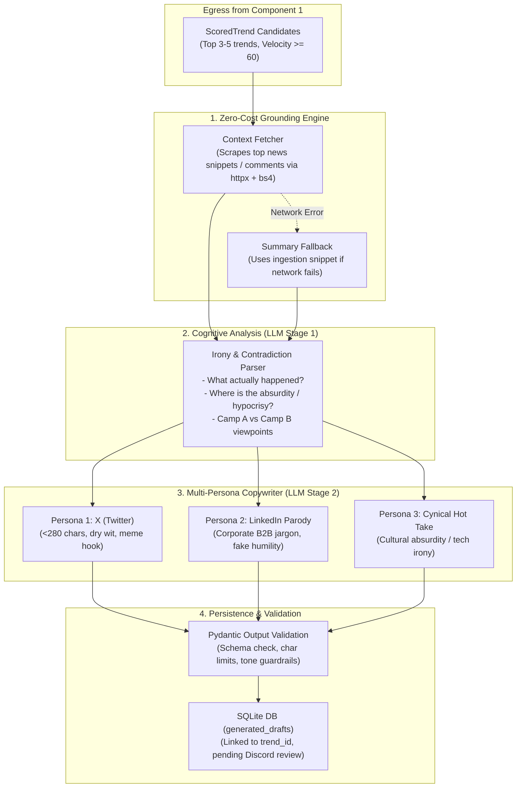

# Component 2 Implementation Plan: Context & Irony Synthesizer (LLM Intelligence Layer)

---

## 1. Objective & Scope

The purpose of **Component 2** is to bridge raw qualified trends from Component 1 into viral, platform-tailored social copy using structured LLM intelligence.

Raw headlines alone lack the nuances necessary to craft effective satire. Component 2 accomplishes three vital tasks:
1. **Grounding & Context Enrichment:** Fetches background context and public reactions for qualified trends without paid APIs (leveraging existing `httpx` and `BeautifulSoup4`).
2. **Conflict & Irony Deconstruction:** Dissects the story into its core contradiction, hypocritical tropes, and opposing perspectives (Camp A vs. Camp B).
3. **Multi-Persona Copywriting:** Generates three ready-to-publish drafts matching distinct platform voices (X/Twitter quip, LinkedIn corporate hustle parody, and cynical cultural hot take) and persists them into SQLite (`generated_drafts`).



---

## 2. In-Depth Architectural Mechanics

### A. Grounding & Zero-Cost Context Fetcher (`intelligence/fetcher.py`)
To produce sharp commentary, the LLM needs more than a 6-word title. It needs key facts, the catalyst, and what internet factions are fighting about.
* **Mechanism:**
  * Uses the existing `trend.url` provided by collectors (Google news link, Reddit post URL, or Hacker News story).
  * If the trend has an external news URL, performs a fast `httpx` GET request with reader headers and extracts the `<article>` text or top paragraphs using `BeautifulSoup4`.
  * If the trend originates from Reddit, uses PRAW or JSON endpoint (`.json`) to pull the top 3-5 upvoted comments to capture the public sentiment pulse.
  * **Zero Cost Fallback:** If scraping is blocked (e.g. paywall, cloudflare 403), the engine gracefully falls back to `trend.summary` and metadata gathered during ingestion. No crashes, zero token waste.

---

### B. Irony & Conflict Deconstruction Engine (`intelligence/prompts.py`)
Humor and viral engagement are rooted in **unresolved tension and hypocrisy**. Before drafting social posts, the synthesizer isolates:
1. **The Catalyst:** What happened in 2 clear sentences?
2. **The Core Contradiction:** What is the absurdity or double standard? (e.g., *"Company spends $10B on AI to write emails faster, but now employees spend all day reading AI-generated emails."*)
3. **The Two Camps:**
   * **Camp A (The Defenders / True Believers):** What is the corporate PR line or fanatic argument?
   * **Camp B (The Skeptics / Cynics):** What is the disgruntled public observation?

---

### C. Multi-Persona Copywriting (`intelligence/drafter.py`)
The synthesizer generates three distinct personas tailored for maximum reach and humor:

#### Persona 1: X (Twitter) — Punchy Observational Quip
* **Tone:** Dry, punchy, observational, slightly deadpan.
* **Format:** Single punchline or setup + twist.
* **Constraints:** **Strictly under 280 characters** (target: 140–220 chars). Zero hashtag spam (maximum 1 topical tag or none).
* **Goal:** High quote-tweet and retweet shareability.

#### Persona 2: LinkedIn — Corporate Hustle Parody
* **Tone:** Parody of self-aggrandizing LinkedIn influencers ("Agree?", "Thoughts?", "Here is what this taught me about leadership...").
* **Format:** Short spaced paragraphs, corporate buzzwords (synergy, paradigm shift, 10x mindset), framing a ridiculous event as a profound business lesson.
* **Constraints:** 150–250 words, ends with an ironic engagement question.

#### Persona 3: Cynical Hot Take — Substack / Tech Cynic
* **Tone:** Acerbic, intellectual satire (similar to Silicon Valley / The Onion / Matt Levine style).
* **Format:** 2–4 sentences exposing the economic or cultural absurdity behind the headline.
* **Goal:** Caters to tech insiders, engineers, and founders who enjoy dark industry humor.

---

## 3. Normalized Data Models (`intelligence/models.py`)

All outputs are strictly validated using Pydantic models before entering the database:

```python
from pydantic import BaseModel, Field
from typing import List, Optional
from datetime import datetime


class TrendGroundingContext(BaseModel):
    """Enriched context gathered from web snippets or discussions."""
    trend_id: int
    headline: str
    key_facts: List[str] = Field(default_factory=list, description="2-3 objective background points.")
    public_sentiment: Optional[str] = Field(default=None, description="What people are debating.")
    raw_source_snippet: Optional[str] = None


class IronyAnalysis(BaseModel):
    """Cognitive breakdown of the humor and debate axes."""
    catalyst_summary: str = Field(description="Objective 2-sentence summary of what happened.")
    core_contradiction: str = Field(description="The underlying hypocrisy, absurdity, or irony.")
    camp_a_perspective: str = Field(description="What proponents/PR are claiming.")
    camp_b_perspective: str = Field(description="What critics/the public are mocking.")


class SocialDraft(BaseModel):
    """Platform-specific social media post draft."""
    platform: str = Field(description="'x', 'linkedin', or 'cynical'")
    content: str = Field(description="Complete post copy.")
    character_count: int = 0
    hook_angle: str = Field(description="The comedic angle utilized.")


class GeneratedDraftBundle(BaseModel):
    """Complete bundle containing irony breakdown and all 3 persona drafts."""
    trend_id: int
    trend_title: str
    irony: IronyAnalysis
    draft_x: SocialDraft
    draft_linkedin: SocialDraft
    draft_cynical: SocialDraft
    model_name: str
    generated_at: datetime = Field(default_factory=datetime.utcnow)
```

---

## 4. LLM Provider Architecture & Prompt Engineering

### A. Provider Agnostic Client (`intelligence/llm_client.py`)
* **Primary Engine:** Google Gemini (via `google-genai` / Gemini 1.5 Flash or Gemini 2.0 Flash) — ultra-fast latency (<1.5s), large context window, generous free tier.
* **Fallback Compatibility:** Built with standard JSON-mode abstraction to easily swap or fallback to OpenAI (`gpt-4o-mini`), Anthropic Claude, or local Ollama.
* **Resilience:** Implements retry logic with exponential backoff for rate limits (`429`) and automated JSON repair if an LLM wraps responses in markdown fences.

### B. Prompt Engineering Architecture
* **System Prompt:** Instructs the LLM on comedy boundaries:
  * *Punch Up:* Target corporate jargon, tech hype, and bureaucratic absurdity.
  * *Never Punch Down:* No jokes about personal tragedies, health crises, or protected categories (enforcing the Tier 1 blacklist).
  * *No Clichés:* Ban overused AI tropes like *"In a world where..."*, *"Buckle up"*, *"Let that sink in"*, *"Plot twist:"*.
* **Few-Shot Demonstration:** Provides 2 concrete before-and-after examples showing how a breaking tech headline translates into the 3 distinct persona voices.

---

## 5. Storage Integration & Database Persistence

The drafts generated in Component 2 populate the existing `generated_drafts` table in `data/agent.db`:

```sql
INSERT INTO generated_drafts (
    trend_id,
    irony_summary,
    draft_x,
    draft_linkedin,
    draft_cynical,
    created_at
) VALUES (?, ?, ?, ?, ?, CURRENT_TIMESTAMP);
```

When Component 3 (Discord Cockpit) is triggered, it directly reads these drafts and populates the interactive Embed and action buttons.

---

## 6. Component 2 Code & Directory Layout

```
trend_copilot/intelligence/
├── __init__.py           # Exports Synthesizer, DraftBundle, ContextFetcher
├── models.py             # Pydantic models (IronyAnalysis, SocialDraft, GeneratedDraftBundle)
├── fetcher.py            # Fast HTTP news/snippet & Reddit context extractor
├── prompts.py            # System instructions, few-shot examples, persona guidelines
├── llm_client.py         # Abstract LLM client wrapper supporting Gemini & OpenAI
├── drafter.py            # Main synthesis orchestrator coordinating grounding + LLM
└── storage.py            # SQLite helper for reading trends & persisting generated drafts
```

---

## 7. Step-by-Step Implementation Sequence

| Sub-Step | Deliverable | How to Validate |
| :--- | :--- | :--- |
| **2.1 Data Models** | Create `trend_copilot/intelligence/models.py`. | Unit test Pydantic validation and character count enforcement. |
| **2.2 Context Fetcher** | Implement `intelligence/fetcher.py` using `httpx` + `bs4`. | Test against live URLs and verify clean snippet extraction with timeout fallbacks. |
| **2.3 Prompts & Templates** | Build `intelligence/prompts.py` with system prompts and few-shots. | Verify prompt rendering with sample `RawTrend` fixtures. |
| **2.4 LLM Client** | Implement `intelligence/llm_client.py` with structured JSON output and retries. | Test with mock client and live Gemini/OpenAI API key. |
| **2.5 Drafter Orchestrator** | Implement `intelligence/drafter.py` combining fetcher + LLM. | Run on a qualified trend, verify all 3 drafts and irony analysis are produced. |
| **2.6 Database Persistence** | Create `intelligence/storage.py` to write results to `generated_drafts`. | Query `agent.db` and verify foreign key link to `trends`. |
| **2.7 Component 1-2 Pipeline Bridge** | End-to-end runner executing Component 1 Ingestion $\to$ Component 2 LLM. | Run CLI command, verify top qualified trends generate full draft bundles. |

---

## 8. Edge Cases, Guardrails & Quality Assurance

1. **Strict Twitter 280-Character Enforcer:** An automatic post-processing trimmer or validator ensures Draft 1 never exceeds 280 characters, recalculating length if emojis or URLs are present.
2. **Context Scraping Paywalls & Timeouts:** If an external news source blocks web scraping with Cloudflare or 403, `ContextFetcher` safely falls back to the Google RSS / Reddit summary within 3 seconds.
3. **LLM Hallucination Mitigation:** Grounding context is injected into the prompt, explicitly instructing the model to stick strictly to the stated facts while satirizing the situation.
4. **Comedic Guardrails:** In addition to the Tier 1 regex blacklist, the prompt instructs the model to immediately return a `status: "inappropriate"` flag if a trend contains unlisted tragic elements.
5. **Cost & Token Efficiency:** The entire context payload is compressed to under 1,000 input tokens per trend, keeping Gemini 1.5/2.0 Flash costs negligible (<$0.0002 per generated trend bundle).
