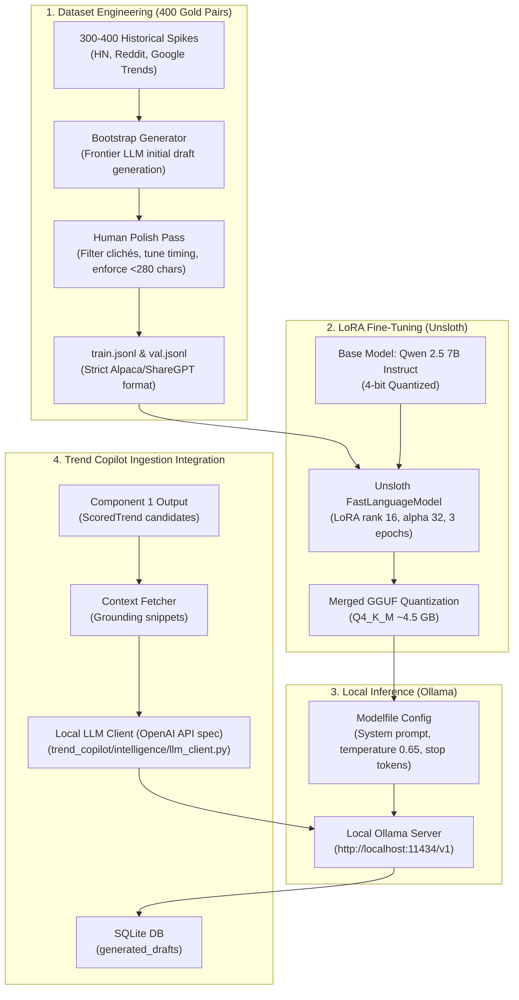

# Custom Local LLM Fine-Tuning & Deployment Plan: Trend Copilot

---

## 1. Executive Objective & Architecture

This plan details the end-to-end engineering roadmap to build, fine-tune, quantize, and deploy a **custom, self-hosted satirical Language Model** specifically trained for the Trend Copilot engine.

Instead of relying on commercial cloud APIs (Gemini, OpenAI, Claude), this architecture:
1. Eliminates third-party API costs ($0 operational token bills).
2. Guarantees 100% data privacy and offline autonomy.
3. Completely suppresses generic "AI cringe" tropes (*"Plot twist"*, *"Buckle up"*, *"Let that sink in"*).
4. Produces publication-ready satirical drafts (X quip, LinkedIn parody, cynical hot take) in **under 1.5 seconds** on consumer hardware.



---

## 2. Dataset Engineering Pipeline (The 400-Pair Gold Standard)

### A. Data Schema Definition
The dataset follows a structured instruction-input-output paradigm saved as `data/finetune/satire_dataset.jsonl`:

```json
{
  "instruction": "You are the Trend Copilot satire engine. Given a breaking news headline and factual grounding context, analyze the core irony (catalyst, contradiction, opposing camps) and generate 3 publication-ready social drafts (X quip, LinkedIn parody, cynical hot take) in valid JSON format.",
  "input": "Headline: Tech conglomerate mandates 5-day return to office while putting 35% of corporate campus up for sublease.\nContext: Internal memo emphasizes 'spontaneous hallway collaboration' while facility planning team confirms hot-desking density will double due to reduced floor space.",
  "output": "{\n  \"irony_analysis\": {\n    \"catalyst\": \"Company mandates 100% in-office attendance while simultaneously downsizing office floor space by over a third.\",\n    \"contradiction\": \"Leadership claims physical presence is irreplaceable for culture, but refuses to provide sufficient physical desks for the employees they ordered back.\",\n    \"camp_a\": \"Executive leadership preaching cross-functional serendipity and corporate accountability.\",\n    \"camp_b\": \"Staff pointing out they are commuting two hours to participate in Zoom calls from cafeteria tables.\"\n  },\n  \"draft_x\": {\n    \"content\": \"Mandating 5 days in the office while quietly subleasing the desks is peak executive efficiency: the collaboration of being on-site with the physical experience of hot-desking in the elevator lobby.\",\n    \"character_count\": 206,\n    \"angle\": \"deadpan_juxtaposition\"\n  },\n  \"draft_linkedin\": {\n    \"content\": \"My CEO just mandated 5 days in-office while selling off the 4th floor.\\n\\nHere's what this taught me about resource scarcity:\\n\\n1. If everyone has a chair, nobody is competing for alpha.\\n2. Standing-room-only quarterly reviews build authentic grit.\\n3. The greatest B2B deliverable is pretending the badge swipe is culture.\\n\\nAre you maximizing density in your cubicle cluster? Agree?\",\n    \"character_count\": 362,\n    \"angle\": \"corporate_lunatic_parody\"\n  },\n  \"draft_cynical\": {\n    \"content\": \"Commercial real estate losses have reached the threshold where forcing senior engineers into open-floor acoustic torture is considered sound balance sheet preservation.\",\n    \"character_count\": 173,\n    \"angle\": \"economic_bathos\"\n  }\n}"
}
```

---

### B. Curated Diversity Split (400 Pairs)
To ensure broad comedic competence across all trending topics, the dataset is stratified into four target domains:

| Category | Proportion | Source Inspiration / Tone |
| :--- | :--- | :--- |
| **Tech Hype & AI Absurdity** | 35% (140 pairs) | Vaporware launches, AI features for 2-line problems, GPU hoarders, startup pivots. |
| **Corporate Jargon & Workplace Drama** | 30% (120 pairs) | RTO mandates, performative layoffs, LinkedIn influencer cringe, synergized redundancies. |
| **Venture Capital & Market Bubbles** | 20% (80 pairs) | Overvalued rounds, founder drama, runway burn rates, pivoting to nuclear energy. |
| **Pop Culture & Internet Controversies** | 15% (60 pairs) | Brand rebrands, celebrity crypto endorsements, PR disaster apologies. |

---

### C. Dataset Generation & Quality Control Script
Create a dataset bootstrapping utility: `scripts/generate_synthetic_dataset.py`:
1. Reads raw seed headlines from past tech/business news feeds.
2. Calls a teacher model (e.g., Claude 3.5 Sonnet / Gemini Pro) with strict few-shot examples to draft candidate pairs.
3. Applies automated validation checks:
   * **Length check:** `len(draft_x) <= 240` characters.
   * **Banned phrase filter:** Rejects samples containing *"Buckle up"*, *"Plot twist"*, *"In a world"*, *"Let that sink in"*, *"Just dropped"*, or more than 1 hashtag.
   * **JSON structure test:** Verifies valid JSON parsing against the Pydantic schema.
4. Splits dataset into `train.jsonl` (360 samples) and `val.jsonl` (40 samples).

---

## 3. Fine-Tuning Execution Pipeline (Unsloth + Qwen 2.5 7B)

### A. Foundation Model Selection
* **Primary Recommendation: `Qwen/Qwen2.5-7B-Instruct`**
  * Top-tier benchmark scores for instruction following and strict JSON emission.
  * Native 32k context support, easily handles multi-page grounding documents.
  * Highly receptive to low-rank adaptation without catastrophic forgetting.
* **Alternative: `meta-llama/Llama-3.1-8B-Instruct`** (similar footprint, strong conversational tone).

### B. Hyperparameter Recipe (Fast LoRA)
```python
# scripts/train_lora_unsloth.py
from unsloth import FastLanguageModel
import torch
from datasets import load_dataset
from trl import SFTTrainer
from transformers import TrainingArguments

# 1. Load 4-bit Base Model
max_seq_length = 2048
model, tokenizer = FastLanguageModel.from_pretrained(
    model_name="Qwen/Qwen2.5-7B-Instruct",
    max_seq_length=max_seq_length,
    load_in_4bit=True,
)

# 2. Configure Parameter-Efficient LoRA Adapters
model = FastLanguageModel.get_peft_model(
    model,
    r=16,                                    # Rank 16 provides optimal style capacity
    target_modules=[
        "q_proj", "k_proj", "v_proj", "o_proj",
        "gate_proj", "up_proj", "down_proj",
    ],
    lora_alpha=32,                           # Alpha = 2 * Rank
    lora_dropout=0,                          # 0 is optimized for Unsloth kernels
    bias="none",
    use_gradient_checkpointing="unsloth",
    random_state=42,
)

# 3. Format Prompt Template
alpaca_prompt = """Below is an instruction that describes a task, paired with an input that provides further context. Write a response that appropriately completes the request.

### Instruction:
{}

### Input:
{}

### Response:
{}"""

def formatting_prompts_func(examples):
    instructions = examples["instruction"]
    inputs       = examples["input"]
    outputs      = examples["output"]
    texts = []
    for inst, inp, out in zip(instructions, inputs, outputs):
        text = alpaca_prompt.format(inst, inp, out) + "<|im_end|>"
        texts.append(text)
    return { "text": texts }

dataset = load_dataset("json", data_files={"train": "data/finetune/train.jsonl"})["train"]
dataset = dataset.map(formatting_prompts_func, batched=True)

# 4. Training Arguments
trainer = SFTTrainer(
    model=model,
    tokenizer=tokenizer,
    train_dataset=dataset,
    dataset_text_field="text",
    max_seq_length=max_seq_length,
    dataset_num_proc=2,
    packing=False,                           # Short samples do not require packing
    args=TrainingArguments(
        per_device_train_batch_size=2,
        gradient_accumulation_steps=4,      # Effective batch size = 8
        warmup_ratio=0.05,
        max_steps=120,                       # ~2.5 epochs across 360 items
        learning_rate=2e-4,                  # Standard LoRA lr
        fp16=not torch.cuda.is_bf16_supported(),
        bf16=torch.cuda.is_bf16_supported(),
        logging_steps=10,
        optim="adamw_8bit",
        weight_decay=0.01,
        lr_scheduler_type="cosine",
        seed=42,
        output_dir="outputs/lora_checkpoints",
    ),
)

# 5. Run Training (~25-35 minutes on single T4/RTX 3060)
trainer.train()

# 6. Export directly to GGUF format for Ollama
model.save_pretrained_gguf(
    "models/trend_copilot_satire_q4",
    tokenizer,
    quantization_method="q4_k_m"
)
```

---

## 4. Local Deployment & Quantization Pipeline (Ollama)

### A. Modelfile Definition
Once `models/trend_copilot_satire_q4/unsloth.Q4_K_M.gguf` is saved, create `models/Modelfile`:

```dockerfile
FROM ./models/trend_copilot_satire_q4/unsloth.Q4_K_M.gguf

# Hyperparameters calibrated for comedic timing and precision
PARAMETER temperature 0.65
PARAMETER top_p 0.90
PARAMETER top_k 40
PARAMETER repeat_penalty 1.15
PARAMETER num_ctx 4096
PARAMETER stop "<|im_end|>"
PARAMETER stop "<|endoftext|>"

# Persistent system instruction baked into local inference
SYSTEM """You are the autonomous Trend Copilot Satire Synthesizer.
Your purpose is to deconstruct breaking news into its core contradiction and compose 3 publication-ready social drafts (X, LinkedIn Parody, Cynical Hot Take).
Constraints:
- Always output strict, valid JSON matching the required schema.
- X drafts must never exceed 240 characters.
- Zero hashtags or maximum 1 topical tag.
- Strictly ban cliché AI openers ('Buckle up', 'Plot twist', 'Let that sink in').
- Never explain the joke."""
```

### B. Ollama Registration Commands
```powershell
# In PowerShell:
ollama create trend-copilot-satire -f models/Modelfile

# Test run directly in terminal:
ollama run trend-copilot-satire "Headline: Google announces AI feature that writes emails to coworkers who will use AI to summarize them."
```

---

## 5. Trend Copilot Python Integration

Update the project configuration and LLM client to talk to the local engine:

### A. Settings Update ([`trend_copilot/config.py`](file:///C:/Users/Srishika/trend_setter/trend_copilot/config.py))
```python
    # LLM Inference Provider
    LLM_PROVIDER: str = Field(
        default="local",
        description="LLM backend: 'local' (Ollama/vLLM), 'gemini', or 'openai'."
    )
    LOCAL_LLM_BASE_URL: str = Field(
        default="http://localhost:11434/v1",
        description="Base URL for local OpenAI-compatible inference server."
    )
    LOCAL_LLM_MODEL: str = Field(
        default="trend-copilot-satire",
        description="Model identifier registered in Ollama."
    )
    LOCAL_LLM_TIMEOUT: float = Field(
        default=60.0,
        description="Timeout in seconds for local model inference."
    )
```

### B. High-Speed Local Client (`trend_copilot/intelligence/llm_client.py`)
```python
import json
import logging
from typing import Dict, Any, Optional
import httpx
from trend_copilot.config import settings
from .models import GeneratedDraftBundle

logger = logging.getLogger("trend_copilot.intelligence.client")

class LocalSatireClient:
    """Communicates with self-hosted Ollama server using OpenAI-compatible endpoints."""

    def __init__(
        self,
        base_url: Optional[str] = None,
        model: Optional[str] = None,
        timeout: Optional[float] = None
    ) -> None:
        self.base_url = base_url or settings.LOCAL_LLM_BASE_URL
        self.model = model or settings.LOCAL_LLM_MODEL
        self.timeout = timeout or settings.LOCAL_LLM_TIMEOUT

    async def generate_drafts(self, prompt: str) -> Optional[GeneratedDraftBundle]:
        """Send prompt to local Ollama model and parse verified JSON."""
        endpoint = f"{self.base_url.rstrip('/')}/chat/completions"
        payload = {
            "model": self.model,
            "messages": [
                {"role": "user", "content": prompt}
            ],
            "temperature": 0.65,
            "response_format": {"type": "json_object"},
        }

        try:
            async with httpx.AsyncClient(timeout=self.timeout) as client:
                res = await client.post(endpoint, json=payload)
                res.raise_for_status()
                data = res.json()
                content = data["choices"][0]["message"]["content"]
                parsed_json = json.loads(content)
                return GeneratedDraftBundle.model_validate(parsed_json)
        except Exception as exc:
            logger.error("Local LLM inference failure: %s", exc, exc_info=True)
            return None
```

---

## 6. Verification & Quality Assurance Suite

### A. The 10-Trend Comedic Benchmark Suite
Evaluate the model against 10 test headlines that traditionally trip up generic LLMs:
1. **The Corporate RTO:** CEO mandates return to office while working remotely from Lake Tahoe.
2. **The AI Feature Fluff:** Software tool that summarizes 2-sentence Slack messages.
3. **The Micro-Layoff:** Company fires 500 workers, immediately announces $50B share buyback.
4. **The Crypto Pivot:** Fast-food brand releases limited edition blockchain loyalty token.
5. **The Startup Burn:** Founder raises $50M pre-revenue seed round to build autonomous lawnmowers.
6. **The Executive Apology:** PR statement regretting "unfortunate friction during workforce transition".
7. **The Cybersecurity Blunder:** Cloud provider leaks customer data due to hardcoded password `"password123"`.
8. **The Social App Redesign:** Photo sharing app replaces feed with full-screen sponsored videos.
9. **The Tech Bro Health Trend:** Silicon Valley biohackers drinking raw untreated mountain water.
10. **The Streaming Price Hike:** Streaming platform introduces unskippable ads on its premium ad-free tier.

### B. Automated Acceptance Gates
* **Gate 1: JSON Validity Rate:** > 99% parse rate without formatting errors.
* **Gate 2: Twitter Length Compliance:** 100% of `draft_x` strictly $\le 240$ characters.
* **Gate 3: Cliché Absence Test:** 0 occurrences of words in `["buckle up", "plot twist", "let that sink in"]`.
* **Gate 4: Latency Benchmark:** Average generation latency $< 2.0$ seconds on GPU (or $< 5.0$ seconds on modern CPU).

---

## 7. Step-by-Step Implementation Sequence

| Step | Milestone | Script / File | Success Criteria |
| :--- | :--- | :--- | :--- |
| **Phase 1** | **Dataset Generation** | `scripts/generate_synthetic_dataset.py` | 400 clean, diverse JSONL pairs created and validated in `data/finetune/`. |
| **Phase 2** | **LoRA Training** | `scripts/train_lora_unsloth.py` | Training converges in ~30 mins; exports valid GGUF file (`Q4_K_M`). |
| **Phase 3** | **Ollama Serving** | `models/Modelfile` | `ollama create trend-copilot-satire` registers and responds to terminal prompts. |
| **Phase 4** | **Python Client** | `trend_copilot/intelligence/llm_client.py` | Async client queries local model, validates Pydantic model with 100% success. |
| **Phase 5** | **End-to-End Test** | `tests/test_intelligence_local.py` | Full pipeline runs from Component 1 trend $\to$ Local LLM $\to$ SQLite storage. |
